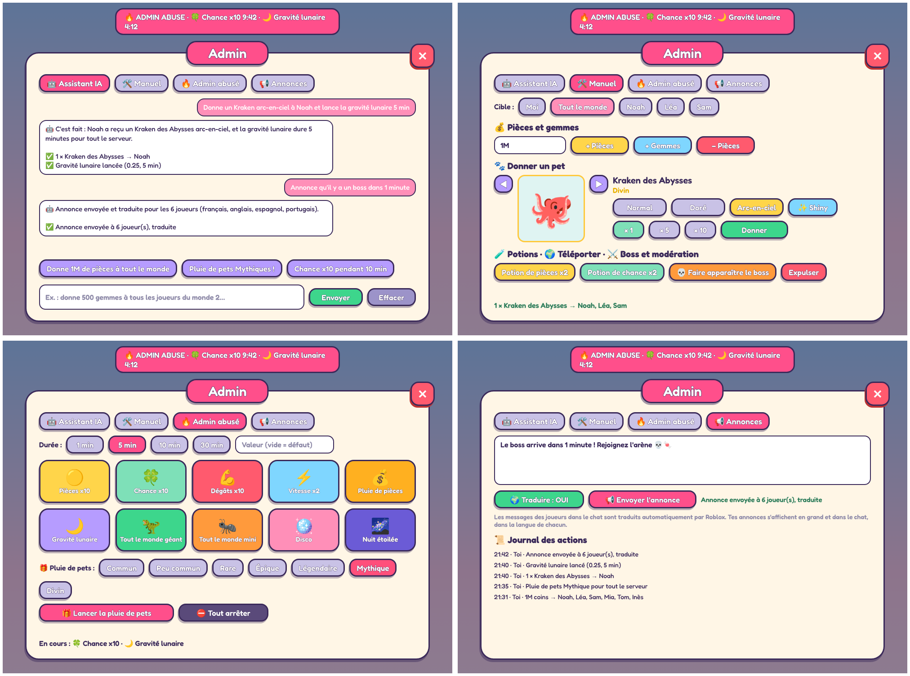

# Sweet Pets Factory (Roblox)

Un simulateur de pets multijoueur sur le thème des bonbons et de la mythologie. On casse des tas de bonbons avec ses pets, on ouvre des œufs et on collectionne 53 pets, du Gumdrop Bunny jusqu'aux créatures **Divines**.

## Lancer le jeu

1. Ouvre **`SweetPetsFactory.rbxlx`** dans Roblox Studio (double-clic, ou Fichier › Ouvrir).
2. Clique sur **Play**. La carte (4 îles et l'arène du boss) est construite automatiquement au démarrage.
3. Pour mettre le jeu en ligne : Fichier › Publier sur Roblox.

**Sauvegarde :** les parties sont enregistrées avec DataStore. Dans Studio, la sauvegarde ne marche qu'une fois le jeu publié et l'option activée dans Game Settings › Security › **Enable Studio Access to API Services**. En attendant, le jeu fonctionne mais ne garde rien.

## Les raretés

| Rareté | Chance dans un œuf | Exemples |
| --- | --- | --- |
| Commun → Légendaire | de 60 % à 0,1 % | Gumdrop Bunny, Mochi Dragon, Golden Gummy King |
| **Mythique** | 0,05 % | Pégase Barbe-à-Papa, Cerbère Guimauve, Sphinx Praliné, Anubis Cacao, Fenrir Lune de Sang, Mammouth d'Ymir, Griffon Céleste, Dragon Céleste, Gummy Golem (boss) |
| **Divin** | 0,004 % (1 sur 25 000) | Hydre d'Olympe, Ra le Phénix Solaire, Kraken des Abysses, Léviathan Cosmique |

Chaque monde suit une mythologie :
- Candy Meadow : la Grèce ;
- Choco Land : l'Égypte ;
- Ice Cream Island : les mythes nordiques ;
- Gummy Galaxy : les créatures célestes.

Les pets Mythiques et Divins sont plus grands. Ils brillent, sont entourés de particules, et leurs auréoles, engrenages ou piliers tournent autour d'eux. Quand un joueur en obtient un, son éclosion déclenche un flash, des rayons et une annonce à tout le serveur.

## Les modèles 3D

Tous les pets sont construits en low-poly à partir de pièces Roblox (blocs, boules, cylindres) dans `src/shared/PetShapes.luau`. Les modèles des pets Mythiques et Divins sont aussi fournis à part, prêts à importer :

- `models/Mythique/*.rbxmx` : les 9 pets Mythiques ;
- `models/Divin/*.rbxmx` : les 4 pets Divins ;
- `models/apercu_mythiques_divins.png` et `models/apercu_tous_les_pets.png` : les aperçus.

Pour importer un modèle dans Studio : clic droit sur Workspace › **Insert from File…**, puis choisis le `.rbxmx`. Dans le jeu, ces modèles sont générés automatiquement : pas besoin de les importer pour jouer.

### Fichiers 3D (.glb et .obj)

`models/3D/<rareté>/` contient chacun des 53 pets en deux formats :
- **`.glb`** : modèle en couleurs, avec ses animations `idle`, `move` et `ability` (boucles de 2 s). Il s'ouvre dans Blender, dans la Visionneuse 3D de Windows ou dans n'importe quel moteur.
- **`.obj` + `.mtl`** : modèle statique en couleurs, le format le plus compatible.

Les 13 Mythiques et Divins sont des modèles détaillés à facettes, de 3 000 à 22 000 triangles : fourrure en éclats, piques de cristal, écailles, objets qui flottent autour (lune de sang, engrenages, colonnes, épaves). Les 40 autres pets (Commun → Légendaire) sont plus simples : 10 espèces mignonnes, décorées selon leur monde (bonbons, baies, chocolat, café, glace, sundae, planètes, étoiles). Plus un pet est rare, plus il a d'accessoires : décoration sur la tête dès Peu commun, collier dès Rare, objets en orbite dès Épique, auréole dorée pour les Légendaires. Les fichiers sources sont dans `tools/web/pets/`.

**Dans le jeu, rien à importer :** les nouveaux modèles sont déjà dans `SweetPetsFactory.rbxlx`, convertis en pièces Roblox (blocs, boules, cylindres et coins). Leurs plans sont dans `src/shared/PetPlans/`, un par pet. Les pièces trop petites sont retirées pour garder le jeu fluide : jusqu'à 150 à 240 pièces pour les pets communs, 650 pour les Mythiques et 900 pour les Divins. Les vignettes de l'interface n'en gardent que les 120 plus grandes.

Pour utiliser les fichiers 3D ailleurs dans Studio : onglet Accueil › **Import 3D** (3D Importer), puis choisis le `.glb` ou le `.obj`. Chaque maillage reste sous la limite de 20 000 triangles.

## Animations

Les pets rares ont un squelette : ailes, têtes, mâchoires, queues, pattes, tentacules, cous. Ils ont 3 animations :

| État | Quand | Exemples |
| --- | --- | --- |
| **Repos** (idle) | le pet attend à côté de toi | ailes qui battent doucement, tentacules qui ondulent |
| **Déplacement** (move) | il te suit ou va vers un tas | pattes qui marchent en diagonale, ailes rapides |
| **Attaque** (ability) | il casse un tas de bonbons ou frappe le boss | morsures des 3 têtes du Cerbère, coups de trompe du Mammouth, cous de l'Hydre qui frappent, hurlement de Fenrir |

Les animations passent en douceur d'un état à l'autre. Les auréoles, les engrenages, les piliers et le soleil de Ra tournent en permanence. Quand tu fais éclore un pet rare, il joue son animation d'attaque pendant la révélation.

Sont animés : les dragons, licornes, rois et fantômes (Légendaires), et tous les Mythiques et Divins.

## Panneau admin

Bouton 🛡️ **Admin** à droite de l'écran, ou touche **K**. Il n'apparaît que pour les admins : le créateur du jeu (ou le propriétaire du groupe), les identifiants mis dans `Config.AdminIds`, et tout le monde quand on teste dans Studio. Le serveur revérifie chaque action.

Quatre onglets :
- **🤖 Assistant IA** : écris ce que tu veux en français (« donne un Kraken arc-en-ciel à Noah et lance la gravité lunaire 5 min ») et l'IA (Claude) le fait avec les mêmes actions que les boutons. Elle demande confirmation avant de remettre une partie à zéro.
- **🛠️ Manuel** : choisis la cible (toi, tout le monde ou un joueur), puis donne des pièces, des gemmes, un pet (normal, doré, arc-en-ciel, shiny), une potion, téléporte, fais apparaître le boss, expulse ou remets une partie à zéro (deux clics).
- **🔥 Admin abusé** : événements pour tout le serveur, avec une bannière et un minuteur chez chaque joueur : pièces x10, chance x10, dégâts x10, vitesse x2, pluie de pièces, gravité lunaire, tout le monde géant ou mini, disco, nuit étoilée, pluie de pets de la rareté choisie. La case « Valeur » change le multiplicateur ou la taille.
- **📢 Annonces** : ton message s'affiche en grand et dans le chat, traduit dans la langue de chaque joueur. Le chat entre joueurs est déjà traduit automatiquement par Roblox. Un journal garde les 40 dernières actions.

### Brancher l'IA (une fois)

L'assistant IA et la traduction utilisent l'API Claude. La partie Manuel et l'Admin abusé marchent sans.
1. Crée une clé API sur [console.anthropic.com](https://console.anthropic.com) (l'utilisation est payante, à quelques centimes la demande).
2. Jeu publié : sur le Creator Hub, ouvre ton expérience › **Secrets**, ajoute un secret nommé `anthropic_api_key`, avec ta clé comme valeur et `api.anthropic.com` comme domaine.
3. Pour tester dans Studio : ajoute une **StringValue** nommée `ClaudeApiKey` dans **ServerStorage** et colle ta clé dans Value. Retire-la avant de publier ou de partager le fichier.
4. Les requêtes HTTP sont déjà activées dans le fichier du jeu (sinon : Game Settings › Security › Allow HTTP Requests).

## Sons

Les sons sont faits dans l'esprit des simulateurs de pets qui marchent : courts, avec une petite basse, des pièces dont le son monte quand tu en ramasses à la suite, un roulement de tambour avant l'éclosion et une révélation qui grossit avec la rareté.

| Son | Quand |
| --- | --- |
| `click`, `open`, `close`, `error` | boutons, ouverture et fermeture des fenêtres, action impossible |
| `tap`, `break`, `coin` | coup sur un tas, tas cassé, pièces ramassées |
| `buy`, `quest` | achat, récompense de quête |
| `hatch` | roulement de tambour et œuf qui craque |
| `reveal`, `reveal_rare`, `legend`, `divine` | révélation : Commun et Peu commun, Rare et Épique, Légendaire et Mythique (aussi la fusion et le rebirth), Divin |

Les fichiers `.ogg` sont dans `dist/SweetPets_Sons/`. Roblox ne lit que les sons envoyés sur ton compte, il faut donc les importer une fois :
1. Dans Studio, onglet **Accueil › Importer**, choisis les 14 fichiers `.ogg` et lance l'import. Ils arrivent dans la Boîte à outils › **Inventaire › Audio** (ou dans le Gestionnaire de ressources).
2. Fais glisser chaque son dans l'Explorer, dans **SoundService › SweetSounds**, en gardant son nom (`click`, `coin`…).
3. Enregistre le jeu. Le jeu trouve chaque son par son nom.

Tant que le dossier est vide, le clic des boutons est muet et quelques sons intégrés à Roblox servent de remplaçants. Le script `tools/sfx/synth.py` régénère les sons.

## Robux (optionnel)

Dans `src/shared/Config.luau`, colle les identifiants de tes Game Passes (`Config.GamePassIds`) et de tes Developer Products (`Config.GemProducts`). Tant qu'un identifiant vaut `0`, l'objet s'achète avec des gemmes gagnées en jeu.

## Commandes

| Action | Touche |
| --- | --- |
| Marcher | ZQSD / WASD, ou toucher l'écran sur mobile |
| Casser un tas | Clic sur le tas |
| Ouvrir un œuf, utiliser le portail ou la porte des mondes | **E** à côté |
| Récolte auto | **F** |
| Pets · Index · Boutique · Quêtes | **P** · **I** · **B** · **J** |
| Mondes · Cadeau · Rebirth | **C** · **G** · **R** |
| Panneau admin (admins seulement) | **K** |

## Pour les développeurs

Le projet suit le format [Rojo](https://rojo.space) : `rojo build default.project.json -o SweetPetsFactory.rbxlx`.

Outils fournis :
- `tools/export_models.luau` et `tools/make_rbxmx.py` : régénèrent les fichiers `.rbxmx` à partir des plans ;
- `tools/gen.sh` : prépare une copie de `Config` utilisable hors de Roblox ;
- `tools/web/rbxexport.js` : régénère `src/shared/PetPlans/` à partir des modèles (`roblox.js` fait la conversion en pièces) ;
- `tools/web/` : l'atelier de modélisation (`forge.js`, `parts.js`, un fichier par créature dans `pets/`) et les exporteurs `.glb`/`.obj` (three.js, à lancer avec Node et Playwright).
